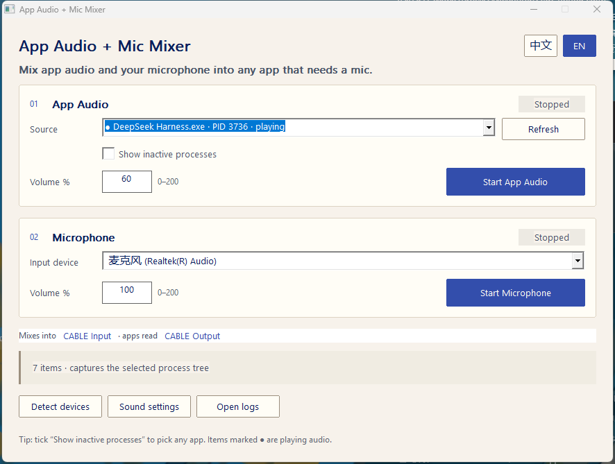

# MicTap

**Per-application audio + your microphone → one virtual microphone, on Windows.**

MicTap captures the sound of *one specific process* (not the whole desktop), optionally mixes your
physical microphone into it, and writes the result to a virtual audio cable. Any app that lets you
choose a microphone — Discord, KOOK, TeamSpeak, Teams, Zoom, OBS, a browser tab — picks it up as a
regular mic.

<p align="center">
  
</p>

<p align="center">
  
  
  
  
</p>

---

## Why this exists

Most "virtual microphone" tools route **everything** the machine plays. That is the wrong unit when
you want music from one player inside a voice call while a game, a browser or a notification stays
out of it.

MicTap uses the **Windows Application Loopback API** (`ActivateAudioInterfaceAsync` +
`VIRTUAL_AUDIO_DEVICE_PROCESS_LOOPBACK`), so the capture scope is a **process ID and its process
tree** — enough to cover multi-process apps such as browsers, Electron players and music clients.

## Features

| | |
| --- | --- |
| **Process-scoped capture** | Pick the exact app; child processes and helper renderers are included, the rest of the desktop is not. |
| **Live mixing with a real mic** | Application audio and a physical microphone are mixed in one engine, on one clock, so the two never drift apart. |
| **Independent lanes** | Start/stop app audio and microphone separately; adjust each gain 0–200 %. |
| **Single executable** | UI and audio engine in one Win32 binary. No .NET runtime, no PowerShell, no installer, no background service. |
| **Bilingual UI** | Chinese and English, switchable at runtime and remembered in `settings.ini`. |
| **High-DPI aware** | Per-Monitor V2; layouts are computed from logical coordinates. |
| **PID reuse guard** | The target is re-verified by executable path and process creation time before capture starts. |
| **Honest failure** | A dead or vanished target reports an error instead of silently streaming silence. |

## Requirements

- Windows 10 build 20348 or newer (Windows 11 recommended) — the process loopback API is not
  available on earlier builds.
- A virtual audio cable. **VB-CABLE** (free) is what this project is tested against:
  [vb-audio.com/Cable](https://vb-audio.com/Cable/) → run `VBCABLE_Setup_x64.exe` as administrator,
  then reboot. You get:
  - playback side `CABLE Input (VB-Audio Virtual Cable)` ← MicTap writes here
  - recording side `CABLE Output (VB-Audio Virtual Cable)` ← your voice app reads here

## Quick start

1. Install VB-CABLE and reboot.
2. Download `MicTap.exe` from [Releases](../../releases), put it in a normal folder such as
   `%LOCALAPPDATA%\Programs\MicTap\`, and run it.
3. In **01 App audio**, pick the app in the *Source* list, set a volume, click **Start App Audio**.
   (Optional) in **02 Microphone**, pick your mic and click **Start Microphone**.
4. In Discord / KOOK / your meeting app: microphone = `CABLE Output (VB-Audio Virtual Cable)`,
   and turn off its automatic gain control and noise suppression.

## Usage notes

- Entries marked `●` are currently rendering audio. *Show inactive processes* lists everything else
  so you can pick an app that is not playing right now.
- Both lanes are independent; either one alone works.
- **Detect devices** re-scans for the cable and refreshes the microphone list, **Sound settings**
  opens the Windows recording panel, **Open logs** shows the diagnostic folder.
- A source or gain can only be changed while that lane is stopped — this keeps the capture graph
  consistent instead of swapping devices underneath a running stream.

## How it works

```
target process (PID + child tree)
        │  Application Loopback, 48 kHz / stereo / float32
        ▼
   capture client ──► deque<float> ──┐
                                     ├─► per-frame sum ─► soft limiter ─► IAudioRenderClient
   physical microphone (WASAPI) ─────┘                                   (CABLE Input)
        │  shared mode, same 48 kHz / stereo / float32                        │
        ▼                                                                     ▼
   capture client                                                   CABLE Output ─► voice app
```

- One engine thread polls both capture clients, mixes on a single sample clock and writes to the
  render client; the UI thread only flips atomic flags.
- Capture and render are opened in **shared mode with `AUTOCONVERTPCM`**, so Windows owns sample
  rate conversion and the app never hand-rolls a resampler.
- A prefetch high-water mark (~50 ms) and a drop threshold (~150 ms) bound latency and prevent
  buffer drift; the write side is only opened once there is data to write.
- The asynchronous activation handler implements `IActivateAudioInterfaceCompletionHandler` and
  `IAgileObject`, keeps the `GetActivateResult` HRESULT separate from the activation HRESULT, and
  keeps its objects alive across a wait timeout.

More detail: [docs/ARCHITECTURE.md](docs/ARCHITECTURE.md).

## Command line self-test

```text
MicTap.exe --dump                        write the process discovery result to logs\discovery.txt
MicTap.exe --route <PID> [seconds] [mic index]
                                         route a process for N seconds, report to logs\route-test.txt
```

`--route` writes a report such as:

```text
pid=12120 cable_input=FOUND
captured_frames=179040 peak=0.653235 queued=0 open=1
mic_frames=240480 mic_peak=0.007327 mic_open=1
```

`open=1` means the capture stream is live, `peak` proves non-silent audio is flowing,
`queued` is the current buffer depth in frames.

## Build from source

Only a C++17 compiler and `windres` are needed (w64devkit is what the release is built with):

```bat
build.cmd            :: -> build\MicTap.exe
build.cmd debug      :: console subsystem, stderr stays visible
```

or by hand:

```bat
windres -I src src\MicTap.rc -O coff -o build\MicTap.res
g++ src\MicTap.cpp build\MicTap.res -std=c++17 -O2 -static -mwindows -municode ^
    -lole32 -luuid -loleaut32 -lmmdevapi -lshell32 -lgdi32 -luser32 -o build\MicTap.exe
```

## Troubleshooting

| Symptom | Cause / fix |
| --- | --- |
| `CABLE Output` missing in the app list | VB-CABLE not installed, or the machine was not rebooted after installing it. |
| The list only shows a handful of processes | The program is running from a directory with restricted process visibility (sandboxed/roaming-profile folders). Move `MicTap.exe` to `%LOCALAPPDATA%\Programs\MicTap\`. |
| Lane runs but the peer hears nothing | The voice app is still using the physical mic — select `CABLE Output`. |
| Captured audio is silence | The target app is paused, muted in the Windows mixer, or uses an exclusive-mode/DRM-protected output. |
| Choppy audio | Set the CABLE control panel sample rate to 48 kHz and keep both lanes at shared mode. |
| Everything is duplicated/echoing | The voice app's own monitoring or a second routing tool is also injecting audio. |

More: [docs/TROUBLESHOOTING.md](docs/TROUBLESHOOTING.md).

## Limitations

- Windows 10 build 20348+ only.
- Exclusive-mode and DRM-protected streams may capture as silence.
- The capture is the application's **post-mix output** (after its own effects), not a raw track.
- A single virtual cable means one mixed program; per-app cables need one cable per stream.

## Privacy

MicTap makes no network requests, ships no telemetry and writes nothing outside its own folder
(`settings.ini`, `logs\`).

## License

[MIT](LICENSE) © 2026 YG

## Acknowledgements

- Microsoft *Application Loopback* sample — the reference for process-scoped WASAPI capture.
- VB-Audio Virtual Cable — the virtual device this project targets (separate donationware product,
  not bundled here).

---

[中文说明 / Chinese README](README.zh-CN.md)
