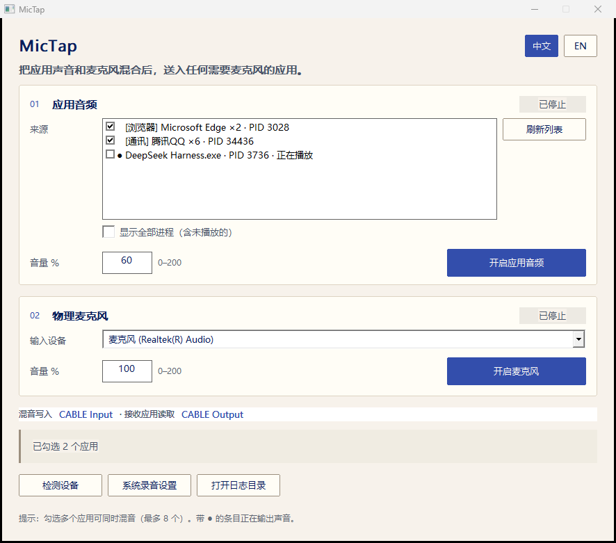

# MicTap

**把某个应用的音频 + 你的麦克风，混成一个虚拟麦克风（Windows）。**

MicTap 只抓**勾选的那几个应用**的声音（不是整个桌面），可以把物理麦克风一起混进去，再写进虚拟声卡。
Discord、KOOK、TeamSpeak、腾讯会议、Zoom、OBS、浏览器网页会议，只要能让选麦克风，就会把它当成
一支普通麦克风。

<p align="center">
  
</p>

## 为什么做这个

多数"虚拟麦克风"工具转发的是**整机**声音。当你只想在语音里放某个播放器的 BGM，而又不想把游戏、
浏览器、系统提示音一起送出去时，那个粒度是错的。

MicTap 用 Windows 的 **Application Loopback**（`ActivateAudioInterfaceAsync` +
`VIRTUAL_AUDIO_DEVICE_PROCESS_LOOPBACK`），捕获范围是**进程 ID 及其进程树** —— 足以覆盖浏览器、
Electron 播放器、音乐客户端这类多进程应用，其余声音一点不碰。

## 功能

| | |
| --- | --- |
| **按应用捕获** | 只选要的那几个应用；子进程与渲染进程一并包含，桌面其余声音不进来。 |
| **多应用混音** | 最多可同时勾选 8 个应用（播放器 + 浏览器 + 游戏），在同一个时钟上相加成一路输出。 |
| **同名进程合并** | 同一个可执行文件的多个进程折叠成一行（`Microsoft Edge ×7`），捕获的是进程树根，渲染进程与辅助进程一并跟随。 |
| **与真实麦克风实时混音** | 两路在同一个引擎、同一个时钟上相加，不会互相走音或错位。 |
| **两路独立** | 应用音频与麦克风各自启停，各自 0–200 % 音量。 |
| **单文件程序** | 界面与音频引擎同一个 Win32 进程；不需要 .NET、不需要 PowerShell、不装服务、不常驻后台。 |
| **中英双语** | 界面右上角即时切换，选择写入 `settings.ini`，下次启动沿用。 |
| **高 DPI** | Per-Monitor V2，布局按逻辑坐标计算，125 % / 150 % 不裁切。 |
| **防 PID 复用** | 启动前用可执行文件路径与创建时间复核目标，避免抓到复用了同一 PID 的别的进程。 |
| **失败要说出来** | 目标进程退出或不存在时明确报错，而不是安静地送静音。 |

## 前置条件

- Windows 10 build 20348 或更高（建议 Windows 11）—— 更早的系统没有进程级回环 API。
- 一块虚拟声卡。本项目实测用 **VB-CABLE**（免费）：
  [vb-audio.com/Cable](https://vb-audio.com/Cable/) → 以管理员运行 `VBCABLE_Setup_x64.exe` → 重启。重启后会有：
  - 播放端 `CABLE Input (VB-Audio Virtual Cable)` ← MicTap 写这里
  - 录音端 `CABLE Output (VB-Audio Virtual Cable)` ← 语音软件读这里

## 快速开始

1. 装好 VB-CABLE 并重启。
2. 从 [Releases](../../releases) 下载 `MicTap.exe`，放到普通目录（例如
   `%LOCALAPPDATA%\Programs\MicTap\`），双击运行。
3. **01 应用音频**：在「来源」列表里**勾选一个或多个应用** → 调音量 → 点 **开启应用音频**。
   需要自己的声音再开 **02 物理麦克风**。
4. 在 Discord / KOOK / 会议软件里：麦克风选 `CABLE Output (VB-Audio Virtual Cable)`，
   并关掉它自带的自动增益与降噪。

## 使用说明

- 条目前的 `●` 表示当前正在输出声音；勾选「显示全部进程」可列出未在播放的应用，方便提前选。
- **勾选多个应用即可同时混音**（最多 8 个）。勾选按「可执行文件路径 + 进程创建时间」记住，重启后自动恢复；
  PID 被系统复用时不会错绑到别的程序。
- 两路互不影响，只开一路也完全可用。
- 底部三个按钮：**检测设备**（重新识别 CABLE、刷新麦克风列表）、**系统录音设置**（打开 Windows
  录音面板）、**打开日志目录**（诊断文件所在目录）。
- 来源与音量只能在该路停止时修改，避免流式管道被中途换设备。

## 原理

```
勾选的应用 #1（PID + 子进程树）──┐
勾选的应用 #2（PID + 子进程树）──┤   Application Loopback，48 kHz / 双声道 / float32
        …  最多 8 个            ──┤
                                 ▼
    物理麦克风（WASAPI）──► 采集客户端 ──► deque<float> ──┐
                                                          ├─► 逐帧相加 ─► 软限幅 ─► IAudioRenderClient
                                                          │                       （CABLE Input）
                                                          ▼                              │
                                                                                  CABLE Output ─► 语音软件
```

- 一个引擎线程轮询每条勾选的采集流加麦克风、按同一采样时钟相加后写出；UI 线程只负责翻转原子标志。
- 采集与输出都是**共享模式 + `AUTOCONVERTPCM`**，采样率转换交给 Windows，程序不自己写重采样。
- 预灌水位约 50 ms、丢弃阈值约 150 ms，兼顾延迟与缓冲漂移；有数据后才打开写出端。
- 异步激活回调实现 `IActivateAudioInterfaceCompletionHandler` 与 `IAgileObject`，
  `GetActivateResult` 自身返回值与激活返回值分开判断，等待超时也不释放对象（避免 UAF）。

细节见 [docs/ARCHITECTURE.md](docs/ARCHITECTURE.md)。

## 命令行自检

```text
MicTap.exe --dump                        把进程发现结果写入 logs\discovery.txt
MicTap.exe --route <PID[,PID…]> [秒数] [麦克风序号]
                                         路由一个或多个应用若干秒，结果写入 logs\route-test.txt
```

`--route` 报告示例：

```text
pid=37932,37964 cable_input=FOUND lanes=2
captured_frames=276480 peak=0.791960 queued=0 open=1
lane1_frames=276480 lane1_peak=0.791960 lane1_open=1
```

`open=1` 表示采集流已建立，`peak` 证明有非静音音频流过，`queued` 是当前缓冲深度（帧）。

## 从源码构建

只需要 C++17 编译器与 `windres`（发布版用 w64devkit 构建）：

```bat
build.cmd            :: -> build\MicTap.exe
build.cmd debug      :: 控制台子系统，能看到 stderr
```

或手动：

```bat
windres -I src src\MicTap.rc -O coff -o build\MicTap.res
g++ src\MicTap.cpp build\MicTap.res -std=c++17 -O2 -static -mwindows -municode ^
    -lole32 -luuid -loleaut32 -lmmdevapi -lshell32 -lgdi32 -luser32 -o build\MicTap.exe
```

## 常见问题

| 现象 | 原因与处理 |
| --- | --- |
| 列表里没有 `CABLE Output` | 没装 VB-CABLE，或装完没重启。 |
| 只列出十几个进程 | 程序跑在进程可见性受限的目录里。把 `MicTap.exe` 移到 `%LOCALAPPDATA%\Programs\MicTap\` 再启动。 |
| 那一路在跑，但对方听不到 | 语音软件还在用物理麦克风 —— 改选 `CABLE Output`。 |
| 捕获到的是静音 | 目标应用被暂停、在音量合成器里被静音，或用了独占模式 / DRM 保护输出。 |
| 声音断续 | 把 CABLE 控制面板采样率设为 48 kHz，两路都保持共享模式。 |
| 出现回声或重复 | 语音软件自身在监听，或另一个路由工具也在注入音频。 |

更多见 [docs/TROUBLESHOOTING.md](docs/TROUBLESHOOTING.md)。

## 限制

- 仅支持 Windows 10 build 20348 及以上。
- 独占模式与 DRM 保护的流可能只能采到静音。
- 采到的是该应用的**混音后输出**（含它自己的音效），不是原始音轨。
- 一块虚拟声卡只能承载一路混音结果；需要多条独立通道就得有对应数量的虚拟线缆。

## 隐私

MicTap 不联网、无遥测，只在自己的目录里写 `settings.ini` 与 `logs\`。

## 许可

[MIT](LICENSE) © 2026 YG

## 致谢

- 微软 *Application Loopback* 示例 —— 进程级 WASAPI 采集的参考实现。
- VB-Audio Virtual Cable —— 本项目对接的虚拟设备（独立的捐赠软件，未随本仓库分发）。

---

[English README](README.md)
